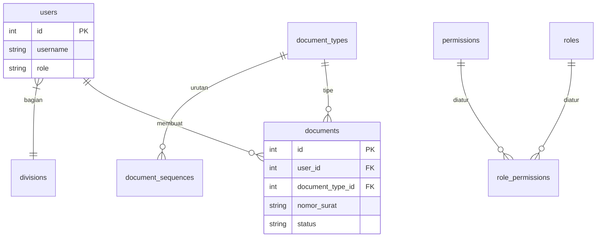

# Kop Surat Management System

Sistem administrasi persuratan internal berbasis CodeIgniter 4 dengan kontrol akses (RBAC) terpadu. Sistem ini mengelola penomoran, verifikasi, arsip naskah dinas, dan tracking audit trail pengguna.

## Tech Stack
- **Framework**: CodeIgniter 4.7
- **PHP**: 8.2+
- **Database**: MySQL/MariaDB
- **PDF Engine**: DomPDF 3.1
- **Auth**: Native Session & Middleware

## Database ERD



## Instalasi

```bash
git clone <repo-url>
composer install
cp env .env
php spark migrate
php spark db:seed RbacSeeder
php spark serve
```

## Folder Struktur

- `app/Controllers`: Logika aplikasi & routing
- `app/Models`: Layer data Surat dan User
- `app/Config`: Konfigurasi sistem, filter auth, database
- `public/`: Entry point (index.php) & aset
- `writable/`: Log, cache, session, uploads

## Kontribusi

1. Fork repository ini.
2. Buat branch fitur: `git checkout -b feature/nama-fitur`.
3. Commit perubahan: `git commit -m 'feat: deskripsi fitur'`.
4. Push ke branch: `git push origin feature/nama-fitur`.
5. Buat Pull Request.

## Lisensi
MIT.

## Riwayat Migrasi (Database)

Migrasi terbaru menambah kolom ke tabel utama:

- `users`: menambah `role_id`, `division_id`, `status`, `deleted_at`, `email`
- `surat`: menambah `user_id`, `division_id`, `document_type_id`
- `roles`, `permissions`, `document_types`, `document_sequences`: tabel induk RBAC penuh

Dokumen terbaru menambah kolom:
- `agenda_number`, `nomor_agenda`, `nama_ditugaskan`, `perihal`, `surat_dari`, `status`, `catatan_admin`, `user_id`
- `document_status_histories`, `document_verifications`, `document_attachments`, `messages`, `system_settings`: tabel audit & tracking penuh