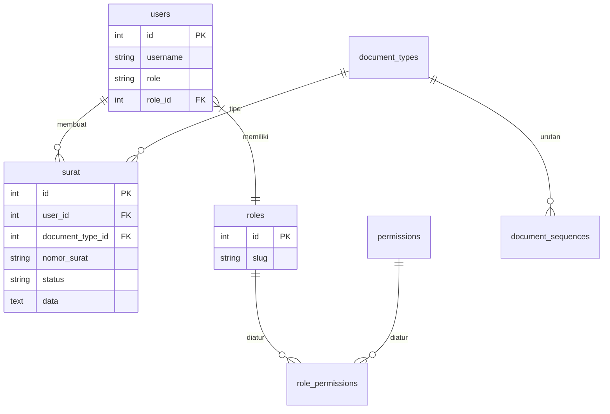

# Kop Surat Management System

Sistem manajemen administrasi persuratan internal berbasis CodeIgniter 4 dengan role-based access control (RBAC) yang ketat. Sistem ini mengelola penomoran, verifikasi, dan arsip naskah dinas.

---

## 🛠 Tech Stack
- **Framework**: CodeIgniter 4.7
- **PHP**: 8.2+
- **Database**: MySQL/MariaDB
- **PDF Engine**: DomPDF 3.1
- **Auth**: Native Session & RBAC Middleware

---

## 🏗 Struktur Database (ERD)



---

## 🚀 Instalasi

1. **Clone & Setup**:
   ```bash
   git clone https://github.com/Baybyo/kop-kop.git
   composer install
   cp env .env
   ```

2. **Konfigurasi (`.env`)**:
   Ubah `app.baseURL` dan pengaturan `database` sesuai environment lokal (XAMPP).

3. **Migrasi Database**:
   ```bash
   php spark migrate
   php spark db:seed RbacSeeder
   ```

4. **Serve**:
   ```bash
   php spark serve
   ```

---

## 🔑 Fitur Utama
- **RBAC**: Akses bertingkat (Superadmin, Admin, User).
- **Penomoran Otomatis**: Generator nomor surat berbasis jenis dokumen & tahun.
- **Audit Trail**: Tracking aksi pengguna (create, approve, reject).
- **Reporting**: Export laporan surat ke CSV.

---

## 📂 Struktur Folder
- `app/Controllers`: Logika bisnis & routing aplikasi.
- `app/Models`: Layer data untuk Surat dan User.
- `app/Config`: Konfigurasi sistem & filter auth.
- `public/`: Entry point (index.php) & assets.
- `writable/`: Log, cache, dan session.

---

## 📝 Kontribusi
1. Fork repository.
2. Buat branch fitur: `git checkout -b feature/nama-fitur`.
3. Commit perubahan: `git commit -m 'feat: deskripsi'`.
4. Push ke branch.
5. Buat Pull Request.

---

## ⚖️ License
MIT License.
